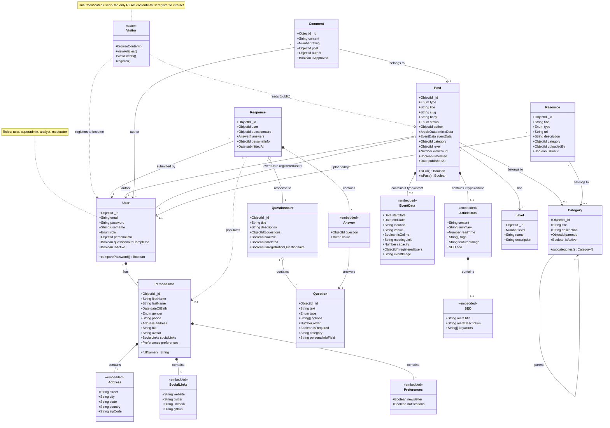

# Blog Backend - Class Diagram

## Complete System Architecture



---

## System Packages Overview

### 0️⃣ Access System (Visitor → User)
```
┌─────────────────────────────────────────────────────────────────┐
│                        ACCESS SYSTEM                             │
├─────────────────────────────────────────────────────────────────┤
│                                                                  │
│   ┌───────────────┐                                             │
│   │   VISITOR     │ ◄─── Unauthenticated (No token)            │
│   │   <<actor>>   │                                             │
│   │               │    CAN:                                     │
│   │               │    ✓ Browse and read all public content    │
│   │               │    ✓ View articles, events, posts          │
│   │               │    ✓ View public questionnaires            │
│   │               │                                             │
│   │               │    CANNOT:                                  │
│   │               │    ✗ Create posts, articles, events        │
│   │               │    ✗ Add comments                          │
│   │               │    ✗ Register for events                   │
│   │               │    ✗ Submit questionnaire responses        │
│   └───────┬───────┘                                             │
│           │                                                      │
│           │ /api/auth/register                                  │
│           ▼                                                      │
│   ┌───────────────┐                                             │
│   │ TEMP TOKEN    │ ◄─── 1 hour validity                       │
│   │ (registration)│                                             │
│   │               │    CAN:                                     │
│   │               │    ✓ Complete registration questionnaire   │
│   │               │                                             │
│   │               │    CANNOT:                                  │
│   │               │    ✗ Access protected routes               │
│   └───────┬───────┘                                             │
│           │                                                      │
│           │ /api/auth/complete-questionnaire                    │
│           ▼                                                      │
│   ┌───────────────┐                                             │
│   │     USER      │ ◄─── Full token (30 days)                  │
│   │ (authenticated)│                                            │
│   │               │    CAN:                                     │
│   │               │    ✓ Everything Visitor can do             │
│   │               │    ✓ Create posts, articles, events        │
│   │               │    ✓ Add comments (rating 1-5)             │
│   │               │    ✓ Register for events                   │
│   │               │    ✓ Update profile                        │
│   │               │    ✓ Submit questionnaire responses        │
│   └───────────────┘                                             │
│           │                                                      │
│           │ Promoted by Superadmin                              │
│           ▼                                                      │
│   ┌───────────────────────────────────────────────────────────┐ │
│   │                    ADMIN ROLES                             │ │
│   ├───────────────────────────────────────────────────────────┤ │
│   │                                                            │ │
│   │   ┌─────────────┐   ┌─────────────┐   ┌─────────────┐     │ │
│   │   │ SUPERADMIN  │   │  ANALYST    │   │ MODERATOR   │     │ │
│   │   │             │   │             │   │             │     │ │
│   │   │ Full access │   │ Questionnaire│  │ Content     │     │ │
│   │   │ to system   │   │ management  │   │ supervision │     │ │
│   │   │             │   │             │   │             │     │ │
│   │   │ CAN:        │   │ CAN:        │   │ CAN:        │     │ │
│   │   │ • Manage    │   │ • Create    │   │ • Review    │     │ │
│   │   │   users     │   │   question- │   │   posts     │     │ │
│   │   │ • Assign    │   │   naires    │   │ • Approve/  │     │ │
│   │   │   roles     │   │ • View all  │   │   reject    │     │ │
│   │   │ • Delete    │   │   responses │   │   content   │     │ │
│   │   │   users     │   │ • Analyze   │   │ • Delete    │     │ │
│   │   │ • All       │   │   user data │   │   posts     │     │ │
│   │   │   admin ops │   │             │   │             │     │ │
│   │   └─────────────┘   └─────────────┘   └─────────────┘     │ │
│   │                                                            │ │
│   └───────────────────────────────────────────────────────────┘ │
│                                                                  │
└─────────────────────────────────────────────────────────────────┘
```

### 1️⃣ User & Authentication System
```
┌─────────────────────────────────────────────────────────────────┐
│                    USER & AUTHENTICATION                         │
├─────────────────────────────────────────────────────────────────┤
│                                                                  │
│   ┌──────────┐                    ┌──────────────┐              │
│   │   USER   │───── 1:0..1 ──────▶│ PERSONAL INFO│              │
│   └──────────┘                    └──────┬───────┘              │
│        │                                 │                       │
│        │                    ┌────────────┼────────────┐         │
│        │                    ▼            ▼            ▼         │
│        │              ┌─────────┐  ┌──────────┐ ┌───────────┐   │
│        │              │ Address │  │SocialLinks│ │Preferences│   │
│        │              │(embedded)│ │(embedded) │ │(embedded) │   │
│        │              └─────────┘  └──────────┘ └───────────┘   │
│        │                                                         │
│        │ Access Levels:                                          │
│        │ • Guest (no token): Read only                          │
│        │ • Temp Token (1h): Complete questionnaire              │
│        │ • Full Token (30d): All features                       │
│        │                                                         │
└────────┴────────────────────────────────────────────────────────┘
```

### 2️⃣ Questionnaire System
```
┌─────────────────────────────────────────────────────────────────┐
│                    QUESTIONNAIRE SYSTEM                          │
├─────────────────────────────────────────────────────────────────┤
│                                                                  │
│   ┌───────────────┐         ┌────────────┐                      │
│   │ QUESTIONNAIRE │── 1:* ──│  QUESTION  │                      │
│   │               │         │            │                      │
│   │ • title       │         │ • text     │                      │
│   │ • isRegistra- │         │ • type     │                      │
│   │   tionQuest.  │         │ • options[]│                      │
│   └───────┬───────┘         │ • personal-│                      │
│           │                 │   InfoField│◄─── Maps to          │
│           │ 1:*             └─────┬──────┘     PersonalInfo     │
│           ▼                       │                              │
│   ┌───────────────┐               │                              │
│   │   RESPONSE    │◄──────────────┘                              │
│   │               │                                              │
│   │ • user        │         ┌────────────┐                      │
│   │ • answers[]   │── 1:* ──│   ANSWER   │                      │
│   │ • personalInfo│         │ (embedded) │                      │
│   └───────┬───────┘         │ • question │                      │
│           │                 │ • value    │                      │
│           │                 └────────────┘                      │
│           │ populates (if registration questionnaire)           │
│           ▼                                                      │
│   ┌───────────────┐                                             │
│   │ PERSONAL INFO │                                             │
│   └───────────────┘                                             │
│                                                                  │
└─────────────────────────────────────────────────────────────────┘
```

### 3️⃣ Content System (Post/Article/Event)
```
┌─────────────────────────────────────────────────────────────────┐
│                       CONTENT SYSTEM                             │
├─────────────────────────────────────────────────────────────────┤
│                                                                  │
│                     ┌──────────────┐                            │
│                     │     POST     │ ◄─── Polymorphic Container │
│                     │              │                            │
│                     │ • type       │                            │
│                     │ • title      │                            │
│                     │ • body       │                            │
│                     │ • status     │                            │
│                     │ • author ────┼──────▶ User                │
│                     │ • category ──┼──────▶ Category            │
│                     │ • level ─────┼──────▶ Level               │
│                     └──────┬───────┘                            │
│                            │                                     │
│         ┌──────────────────┼──────────────────┐                 │
│         │ type='article'   │    type='event'  │                 │
│         ▼                  │                  ▼                 │
│   ┌───────────┐            │            ┌───────────┐           │
│   │  ARTICLE  │            │            │   EVENT   │           │
│   │           │            │            │           │           │
│   │ • content │            │            │ • startDate│          │
│   │ • summary │            │            │ • endDate │           │
│   │ • tags[]  │            │            │ • location│           │
│   │ • seo ────┼──┐         │            │ • capacity│           │
│   └───────────┘  │         │            │ • register│           │
│                  ▼         │            │   edUsers│───▶ User[] │
│            ┌─────────┐     │            └───────────┘           │
│            │   SEO   │     │                                     │
│            │(embedded)│    │                                     │
│            └─────────┘     │                                     │
│                            │                                     │
│                            ▼                                     │
│                     ┌──────────────┐                            │
│                     │   COMMENT    │                            │
│                     │              │                            │
│                     │ • content    │                            │
│                     │ • rating     │                            │
│                     │ • author ────┼──────▶ User                │
│                     │ • isApproved │                            │
│                     └──────────────┘                            │
│                                                                  │
└─────────────────────────────────────────────────────────────────┘
```

### 4️⃣ Classification System
```
┌─────────────────────────────────────────────────────────────────┐
│                    CLASSIFICATION SYSTEM                         │
├─────────────────────────────────────────────────────────────────┤
│                                                                  │
│   ┌───────────────┐              ┌───────────────┐              │
│   │   CATEGORY    │              │     LEVEL     │              │
│   │               │              │               │              │
│   │ • title       │              │ • level (num) │              │
│   │ • description │              │ • name        │              │
│   │ • parentId ───┼──┐           │ • description │              │
│   │ • isActive    │  │           │               │              │
│   └───────────────┘  │           └───────────────┘              │
│          ▲           │                   ▲                       │
│          │           │                   │                       │
│          └───────────┘                   │                       │
│        (self-reference                   │                       │
│         for hierarchy)                   │                       │
│                                          │                       │
│   Used by:                               │                       │
│   • Post.category ───────────────────────┤                       │
│   • Resource.category                    │                       │
│   • Post.level ──────────────────────────┘                       │
│                                                                  │
└─────────────────────────────────────────────────────────────────┘
```

### 5️⃣ Resource System
```
┌─────────────────────────────────────────────────────────────────┐
│                      RESOURCE SYSTEM                             │
├─────────────────────────────────────────────────────────────────┤
│                                                                  │
│   ┌───────────────┐                                             │
│   │   RESOURCE    │                                             │
│   │               │                                             │
│   │ • title       │                                             │
│   │ • type ───────┼──── [document, video, link, image, file]   │
│   │ • url         │                                             │
│   │ • description │                                             │
│   │ • category ───┼──────▶ Category                            │
│   │ • uploadedBy ─┼──────▶ User                                │
│   │ • isPublic    │                                             │
│   └───────────────┘                                             │
│                                                                  │
└─────────────────────────────────────────────────────────────────┘
```

---

## Relationship Summary

### Composition (Owns Lifecycle) `*--`
| Parent | Child | Description |
|--------|-------|-------------|
| User | PersonalInfo | User owns their profile |
| PersonalInfo | Address | Address embedded in PersonalInfo |
| PersonalInfo | SocialLinks | SocialLinks embedded |
| PersonalInfo | Preferences | Preferences embedded |
| Article | SEO | SEO metadata embedded |
| Response | Answer[] | Answers embedded in Response |

### Aggregation (Has Reference) `o--`
| Parent | Child | Description |
|--------|-------|-------------|
| Post | Article | Post references Article (if type='article') |
| Post | Event | Post references Event (if type='event') |
| Questionnaire | Question | Questionnaire has questions |
| Event | User[] | Event has registered users |

### Association (References) `-->`
| From | To | Cardinality | Description |
|------|-----|-------------|-------------|
| Post | User | *:1 | Posts have author |
| Post | Category | *:0..1 | Posts belong to category |
| Post | Level | *:0..1 | Posts have difficulty level |
| Comment | Post | *:1 | Comments belong to post |
| Comment | User | *:1 | Comments have author |
| Response | User | *:1 | Responses submitted by user |
| Response | Questionnaire | *:1 | Responses to questionnaire |
| Resource | User | *:0..1 | Resources uploaded by user |
| Resource | Category | *:0..1 | Resources in category |
| Category | Category | *:0..1 | Categories have parent |

### Dependency (Creates/Populates) `..>`
| From | To | Description |
|------|-----|-------------|
| Response | PersonalInfo | Registration response creates PersonalInfo |

---

## Registration & Access Flow

```
┌─────────────────────────────────────────────────────────────────┐
│                         ACCESS FLOW                              │
└─────────────────────────────────────────────────────────────────┘

    VISITOR (No Token) <<actor>>
    ════════════════════════════
    ✓ GET /api/posts (public posts)
    ✓ GET /api/articles (all published)
    ✓ GET /api/articles/:slug
    ✓ GET /api/events (all events)
    ✓ GET /api/events/:id
    ✓ GET /api/questionnaires (non-registration)
    ✗ Cannot create, comment, or register for events
                │
                │ Wants to interact? → Register
                ▼
    ┌───────────────────────────────────────┐
    │  POST /api/auth/register              │
    │  Body: { email, password, username }  │
    │                                       │
    │  Response:                            │
    │  • tempToken (1 hour)                 │
    │  • Registration questionnaire         │
    └───────────────────┬───────────────────┘
                        │
                        │ Fill questionnaire
                        ▼
    ┌───────────────────────────────────────┐
    │  POST /api/auth/complete-questionnaire│
    │  Header: Authorization: Bearer <temp> │
    │  Body: { answers: [...] }             │
    │                                       │
    │  Process:                             │
    │  1. Validate required questions       │
    │  2. Create Response                   │
    │  3. Extract PersonalInfo from answers │
    │  4. Link PersonalInfo to User         │
    │  5. Set questionnaireCompleted = true │
    │                                       │
    │  Response:                            │
    │  • Full access token (30 days)        │
    └───────────────────┬───────────────────┘
                        │
                        ▼
    AUTHENTICATED USER (Full Token)
    ════════════════════════════════
    ✓ All guest capabilities
    ✓ POST /api/articles (create)
    ✓ POST /api/events (create)
    ✓ POST /api/posts/:id/comments
    ✓ POST /api/events/:id/register
    ✓ PUT /api/users/profile/update
    ✓ All protected routes
```

---

## PersonalInfo Field Mapping

When completing the registration questionnaire, answers are mapped to PersonalInfo fields using `question.personalInfoField`:

| personalInfoField | PersonalInfo Field | Example Answer |
|-------------------|-------------------|----------------|
| `firstName` | firstName | "John" |
| `lastName` | lastName | "Doe" |
| `dateOfBirth` | dateOfBirth | "1990-05-15" |
| `gender` | gender | "male" |
| `phone` | phone | "+1234567890" |
| `bio` | bio | "Software developer..." |
| `address.street` | address.street | "123 Main St" |
| `address.city` | address.city | "New York" |
| `address.state` | address.state | "NY" |
| `address.country` | address.country | "USA" |
| `address.zipCode` | address.zipCode | "10001" |
| `socialLinks.website` | socialLinks.website | "https://..." |
| `socialLinks.twitter` | socialLinks.twitter | "@johndoe" |
| `socialLinks.linkedin` | socialLinks.linkedin | "linkedin.com/in/..." |
| `socialLinks.github` | socialLinks.github | "github.com/..." |
| `preferences.newsletter` | preferences.newsletter | true |
| `preferences.notifications` | preferences.notifications | true |
