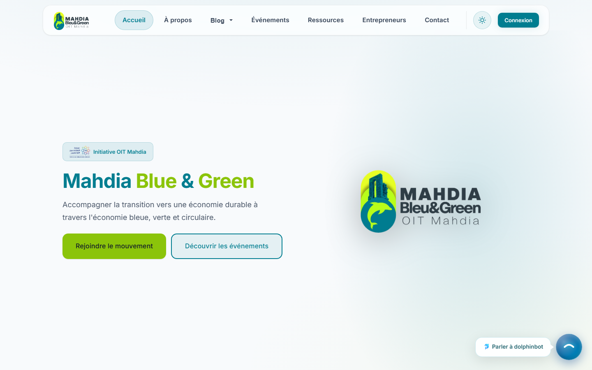
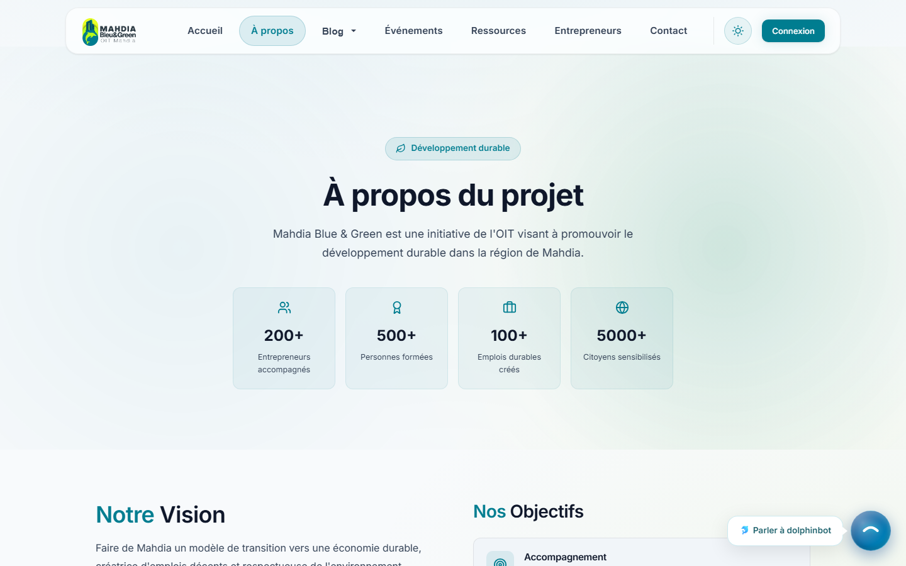
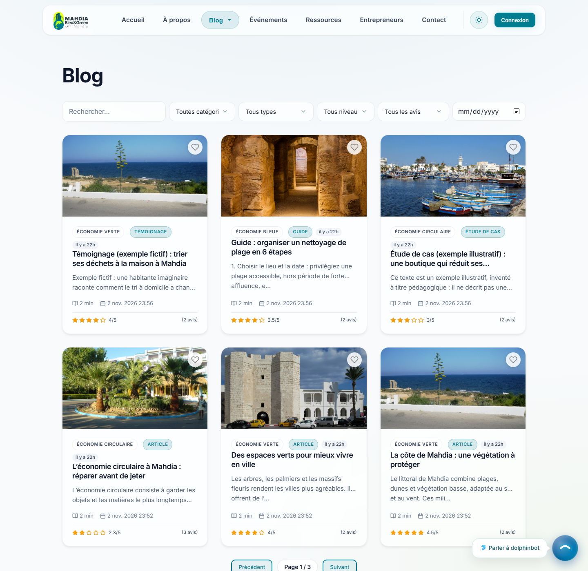
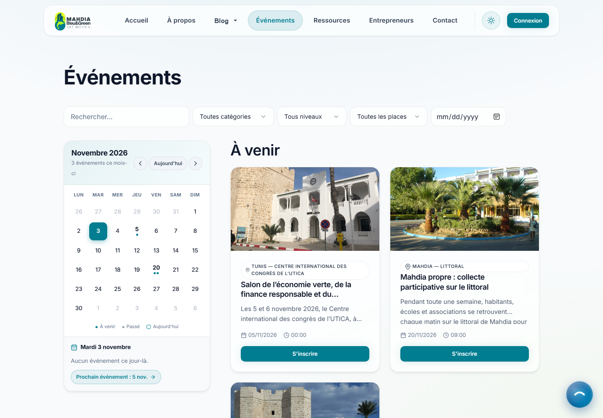
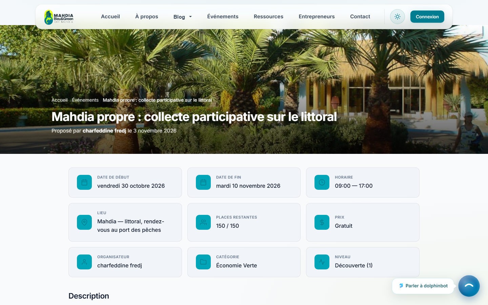
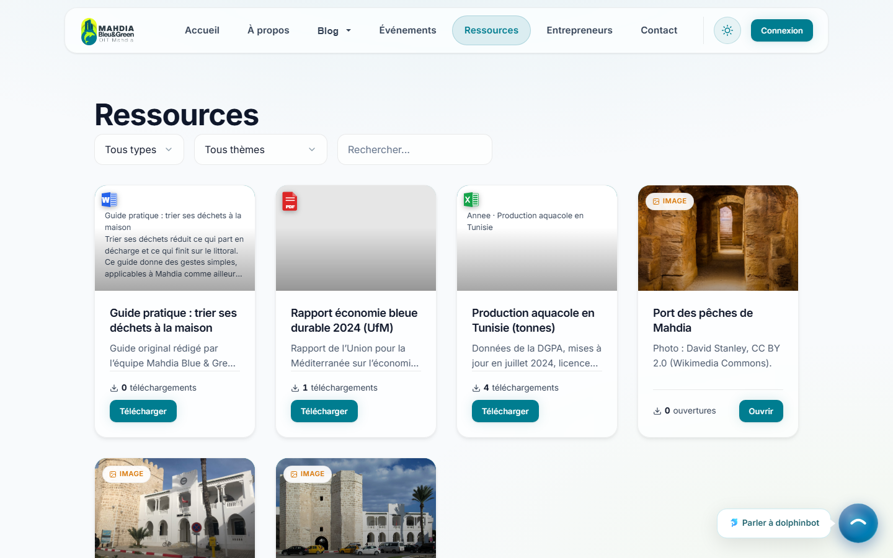
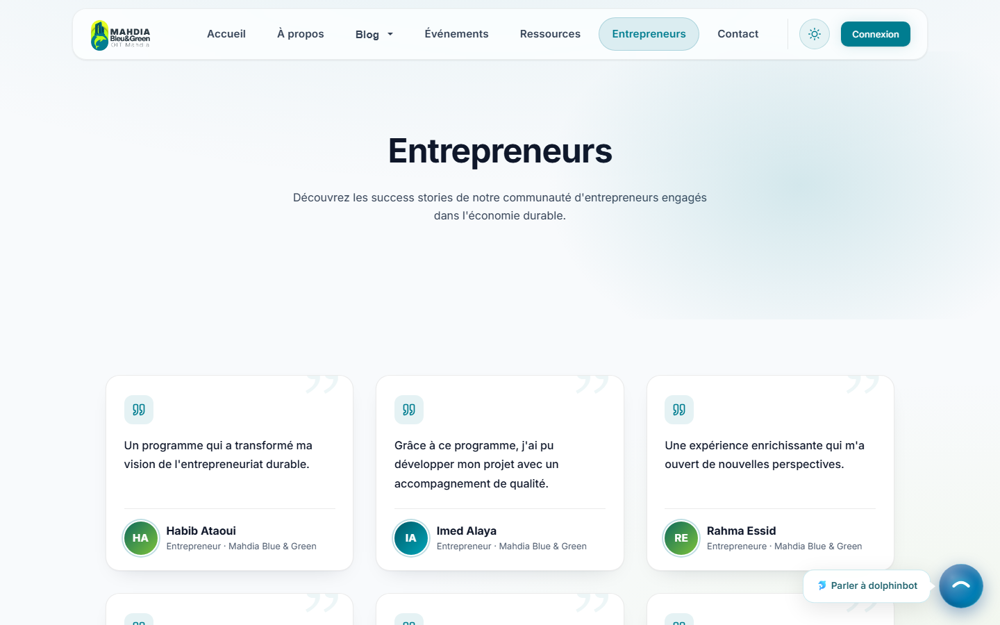
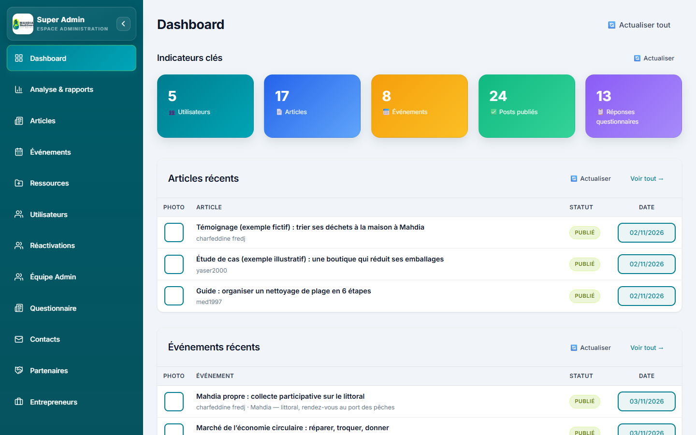
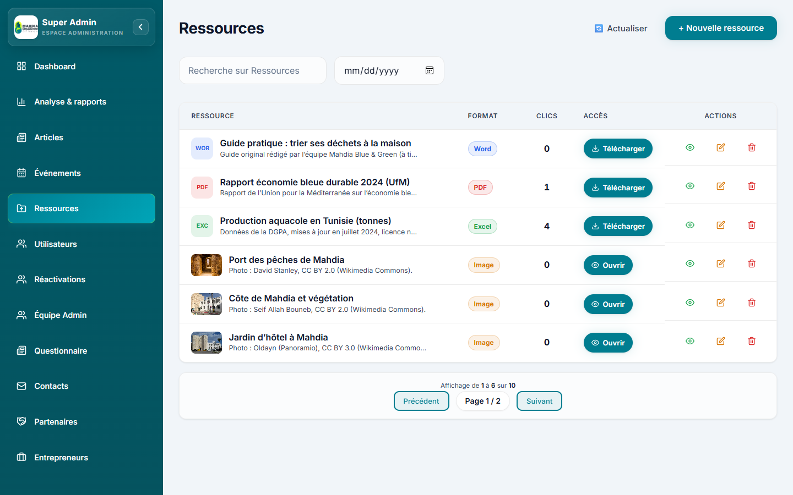
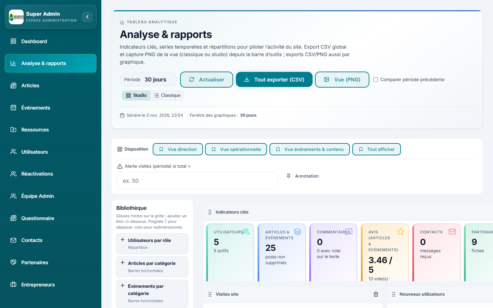

# 🌟 Mahdia Blue & Green

## 🚀 Project Description

Mahdia Blue & Green is a full-stack web platform that promotes the **blue** (sea), **green** and **circular** economy in the Mahdia region of Tunisia. It is an initiative of the Mahdia regional council of the Tunisian Order of Engineers (OIT). It publishes articles, events and resources, showcases local entrepreneurs, and gives content teams an admin panel to manage everything.
The application is built as a **single-page React frontend** and a **REST API** built with Express and MongoDB. It also includes an **AI assistant** (chatbot) powered by OpenRouter.


---

## 🎯 Main Features

### 🌍 Visitor
- 📰 Read articles, guides and testimonials on the blog, with filters by category and type
- 📅 Browse the events calendar and open event pages
- 📚 Access resources: documents, spreadsheets and images
- 🧑‍🤝‍🧑 Discover local entrepreneurs and the economy sectors
- ✉️ Contact the team and subscribe to the newsletter
- 🤖 Chat with the AI assistant

### 👤 Registered User
- 📝 Complete the registration questionnaire to build a profile
- ✍️ Submit articles and events, which are published after moderation
- 🔐 Manage the profile and enable two-factor authentication (QR code)
- 🔑 Sign in with email and password, or with Google

### 🛡️ Moderator
- ✅ Approve or reject submitted articles and events, including event changes
- 🗑️ Delete any post
- 🧾 Manage entrepreneurs, partners, team members and newsletter subscribers
- 📬 Handle contact messages

### 📊 Analyst
- 📈 Consult the analytics dashboards and export them (CSV, PNG)
- 🧠 Create and manage registration questionnaires and read the responses
- 💬 Read and reply to contact messages

### 🧑‍💻 Superadmin
- 🔧 Full control of the system: users, roles, admin team, content and settings
- 👥 Manage admin accounts and reactivate user accounts

---

## 🔧 Technologies Used

### Frontend
- ⚛️ React 19 with Vite 7
- 🧭 React Router
- ✏️ TipTap rich-text editor
- 📊 Recharts for dashboards and analytics
- 🎨 Lucide icons

### Backend
- ⚙️ Node.js with Express
- 🍃 MongoDB with Mongoose
- 🔐 JWT, Passport (Google OAuth) and TOTP two-factor authentication
- ☁️ Cloudinary for image uploads
- 📧 Nodemailer for verification and password-reset emails

### Security
- 🛡️ Helmet, rate limiting, input validation and sanitization, NoSQL-injection protection

### AI
- 🤖 OpenRouter for the chat assistant

### Architecture
- 🔗 Single-page application with a REST API

---

## 🎯 Objective

The project aims to promote the sustainable economy in Mahdia by informing citizens, supporting local entrepreneurs, and publishing events and resources. It also gives content teams a secure admin panel to manage the platform, with a moderation workflow and analytics.

---

## 🛠️ Installation and Setup

### 1️⃣ Install Dependencies

Prerequisites: Node.js 20.19+ or 22.12+ (required by Vite 7), and a MongoDB database (local or MongoDB Atlas).

```bash
git clone https://github.com/CharfeddineFredj/Mahdia-Blue-Green-Portfolio.git
cd Mahdia-Blue-Green-Portfolio
```

#### Backend
Navigate to the backend folder and install dependencies:
```bash
cd Backend
npm install
```

#### Frontend
Navigate to the frontend folder and install dependencies:
```bash
cd Frontend
npm install
```

---

### 2️⃣ Configure Environments

#### Backend
Copy the `.env.example` file and rename it to `.env`, then fill in the values:
```bash
cp .env.example .env
```
Configure at least the database, authentication and first superadmin account:
```
MONGODB_URI=your_mongodb_connection_string
JWT_SECRET=a_long_random_string
SUPERADMIN_EMAIL=your_admin_email
SUPERADMIN_USERNAME=superadmin
SUPERADMIN_PASSWORD=a_strong_password
```
The SMTP, Cloudinary, Google OAuth and OpenRouter variables enable the corresponding features. See `.env.example` for the full list.

#### Frontend
Copy the `.env.example` file to `.env` in the frontend folder:
```
VITE_API_URL=http://localhost:5000/api
VITE_ENABLE_CHATBOT=true
```

Never commit your real `.env` files.

---

### 3️⃣ Prepare the Database

No migration is needed. On first start, the API:
- creates the superadmin account from the `SUPERADMIN_*` variables
- loads the initial content from `Backend/data`, only the first time

---

### 4️⃣ Start the Project

#### Backend
Run the API in development mode:
```bash
cd Backend
npm run dev
```

#### Frontend
Run the Vite development server:
```bash
cd Frontend
npm run dev
```

#### Tests (optional)
```bash
cd Backend
npm test
```

---

## 5️⃣ Access the Application

### Frontend
Open your browser and go to:
```
http://localhost:5173
```

### Backend
The backend API is available at:
```
http://localhost:5000/api
```

---

## 🚀 Features to Test

- 📰 Blog: browse, filter and read articles
- 📅 Events: open the calendar, view an event and register
- 🔐 Account: sign up, verify your email, sign in and enable two-factor authentication
- ✍️ Submit an article or event, then approve it as a moderator
- 📈 Dashboard and analytics as superadmin or analyst
- 🤖 Chat with the AI assistant

---

## 🖼️ Screenshots

### 🖥️ Web Interface - Home


### 🖥️ Web Interface - About


### 🖥️ Web Interface - Blog


### 🖥️ Web Interface - Events


### 🖥️ Web Interface - Event Detail


### 🖥️ Web Interface - Resources


### 🖥️ Web Interface - Entrepreneurs


### 🛠️ Admin Interface - Dashboard


### 🛠️ Admin Interface - Resources


### 🛠️ Admin Interface - Analytics


---
